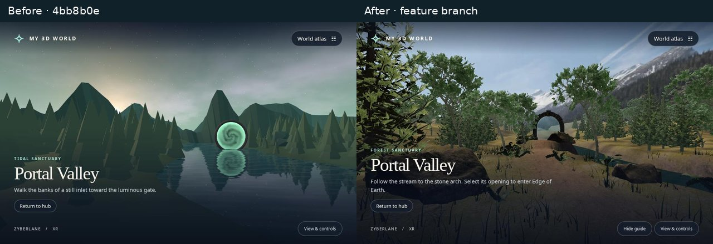

# Portal Valley rebuild verification

The final Low profile reduced the continuous-run median frame interval from **84.9 ms on the original** and **151.0 ms on the first art candidate** to **56.0 ms**. The High exploration route regressed from **110.3 to 398.7 ms** despite fewer draw calls. High submits about six times the triangles on that route. The target of stable 30 FPS remains unverified on Android and was missed on this software renderer.

## Table A · visual quality

| World | Existing problem | Implemented change | Visual evidence | Result | Remaining limitations |
| --- | --- | --- | --- | --- | --- |
| Portal Valley | Cone-shaped trees, uniform banks and angular distant ridges | Photo-textured gravel, moss and rock, a scanned boulder, instanced vegetation, mountain panorama, image-based lighting, a walkable stream and stone arch | [Before](evidence/rebuild/before/valley-desktop.jpg) · [After](evidence/rebuild/after/valley-desktop.jpg) | The walker can approach textured rocks and plants while retaining the view of the mountain pass. The arch gives the path a destination. | Distant mountains are a panorama, distant trees use flat impostors, and close-up foliage repetition remains visible. |
| Observatory | Stylized ridges and gates | Existing court retained with revised gallery navigation | [Before](evidence/rebuild/before/hub-desktop.jpg) · [After](evidence/rebuild/after/hub-desktop.jpg) | Hub remains navigable | Separate art pass pending |
| Edge of Earth | Simplified cliff and cloud geometry | Route retained and linked from the valley arch | [Before](evidence/rebuild/before/earth-desktop.jpg) · [After](evidence/rebuild/after/earth-desktop.jpg) | Destination loads | Dedicated visual rebuild pending |
| Starlight Field | Stylized terrain and blossoms | Existing route retained | [Before](evidence/rebuild/before/field-desktop.jpg) · [After](evidence/rebuild/after/field-desktop.jpg) | Composition preserved | Dedicated visual rebuild pending |
| Particle Sculpture Room | No prior device-performance signoff | Integrates tier-based particle count | [Before](evidence/rebuild/before/sculpture-desktop.jpg) · [After](evidence/rebuild/after/sculpture-desktop.jpg) | Six form controls tested | Physical interaction feel pending |
| Hand Tracking Particle Lab | Camera overlay could obscure controls in short landscape layouts | Landscape controls repaired; tracking latency measured separately | [Before](evidence/rebuild/before/lab-desktop.jpg) · [After](evidence/rebuild/after/lab-desktop.jpg) | Manual controls and synthetic camera fixture verified | Real hand accuracy and physical-camera latency unmeasured |

## Table B · performance by device

The measurements use Chromium 153 on ANGLE SwiftShader at 480 × 300, DPR 1. Each entrance tier has 39 sampled intervals following warm-up. FPS is 1,000 divided by median frame time. Load time comes from a separate cold desktop Auto navigation. Peak memory is JavaScript heap in the entrance sample. The graphics wrapper counts nested shadow and reflection draws.

| Device/browser | Scene | Quality | Median FPS | Median / P95 frame time (ms) | Cold load (ms) | Peak heap (MiB) | Verdict |
| --- | --- | --- | ---: | ---: | ---: | ---: | --- |
| Chromium / software renderer | Original Valley | Low | 58.8 | 17.0 / 96.0 | 3478 | 24.6 | Large frame-time spikes |
| Chromium / software renderer | Original Valley | High | 14.3 | 69.7 / 203.9 | 3478 | 20.9 | Below 60 FPS |
| Chromium / software renderer | Rebuilt Valley | Low | 17.7 | 56.4 / 165.7 | 1646 | 18.2 | Slower than the original's short Low entrance sample |
| Chromium / software renderer | Rebuilt Valley | Balanced | 4.9 | 202.3 / 438.2 | 1646 | 20.7 | Below target |
| Chromium / software renderer | Rebuilt Valley | High | 3.5 | 287.7 / 570.2 | 1646 | 14.5 | Below target |
| Redmi 15 / Chrome | Rebuilt Valley | Auto and Low | — | — | — | — | Hardware test pending |
| Native-GPU desktop | Rebuilt Valley | Balanced and High | — | — | — | — | Hardware test pending |
| WebXR headset | Rebuilt Valley | Auto | — | — | — | — | Native refresh and comfort pending |

### Frame pacing, workload and resource trends

| Matched High route | Median (ms) | P95 (ms) | Worst (ms) | Median update and render submission (ms) | Median draw calls | Median submitted triangles |
| --- | ---: | ---: | ---: | ---: | ---: | ---: |
| Original | 110.3 | 250.3 | 652.3 | 1.4 | 41 | 125,290 |
| Rebuild | 398.7 | 834.1 | 1235.7 | 1.5 | 27 | 756,878 |

| Low workload | Entrance calls | Entrance triangles | Sustained median (ms) | Sustained P95 (ms) | Sustained worst (ms) |
| --- | ---: | ---: | ---: | ---: | ---: |
| Original | 43 | 125,210 | 84.9 | 239.8 | 508.7 |
| First art candidate | 14 | 130,437 | 151.0 | 345.8 | 1456.0 |
| Corrected candidate | 14 | 50,785 | 56.0 | 113.4 | 888.3 |

The corrected Low path reduced geometry and terrain shading cost. It improved sustained median and P95 over the original while its worst observed frame was longer. The short entrance test and sustained test give different results on this machine. Stable real-device performance remains an open gate.

The original and final Valley profiling visits recorded two and six main-thread long tasks respectively. JavaScript heap, Three.js counts and actual VRAM bytes are distinct measures. Three repeated returns to the hub are recorded in the raw traces and independently checked in the functional suite. GPU-memory byte totals were unavailable. Two valid asynchronous graphics time queries per revision, without a disjoint result, were 93.0 and 196.5 ms for the original, and 424.8 and 253.1 ms for the rebuild. This small software-GPU sample cannot characterize physical hardware.

Cold local Valley transfer increased from **543,166 to 3,403,090 bytes**, including HTML and shared application code. The candidate hub transferred **619,959 bytes** without requesting valley assets. Load times are single local observations without CDN compression or network throttling. Per-asset load/parse durations in the final JSON overlap and should not be summed.

## Evidence and reproducibility

1. [Frame time across the matched High route](evidence/rebuild/charts/1-frame-time.png)
2. [Cold load time and HTTP transfer by destination](evidence/rebuild/charts/2-loading.png)
3. [Draw calls and triangle workload by tier](evidence/rebuild/charts/3-workload.png)
4. [Inference and gesture activation latency](evidence/tracking/latency.png) · [Fixture, delegate and timing details](evidence/tracking/README.md)
5. [Frame-time trend over sustained use](evidence/rebuild/charts/5-sustained.png)

[Harness, measurement definitions and reproduction instructions](evidence/rebuild/README.md) · [Original trace](evidence/rebuild/data/baseline-numbers.json) · [Intermediate art candidate](evidence/rebuild/data/candidate-initial-numbers.json) · [Final candidate](evidence/rebuild/data/candidate-numbers.json) · [Original graphics queries](evidence/rebuild/data/baseline-gpu.json) · [Final graphics queries](evidence/rebuild/data/candidate-gpu.json)

## Matched visual inspection

| Inspection | Original | Candidate | Observation |
| --- | --- | --- | --- |
| Ground and foreground detail | [Close-up](evidence/rebuild/before/valley-close.jpg) | [Close-up](evidence/rebuild/after/valley-close.jpg) | Gravel, moss and fern silhouettes are individually readable. |
| Water and banks | [River](evidence/rebuild/before/valley-water.jpg) | [River](evidence/rebuild/after/valley-water.jpg) | The stream sits within shaped banks. Reflection fidelity varies by tier. |
| Light and depth | [Lighting](evidence/rebuild/before/valley-light.jpg) | [Lighting](evidence/rebuild/after/valley-light.jpg) | Near vegetation and distant mountains now establish different depth layers. |
| Portrait framing | [390 × 844](evidence/rebuild/before/valley-mobile.jpg) | [390 × 844](evidence/rebuild/after/valley-mobile.jpg) | Phone-sized viewport captured; handset display acceptance pending. |
| Stereo layout | [Split](evidence/rebuild/before/valley-stereo.jpg) | [Split](evidence/rebuild/after/valley-stereo.jpg) | Both viewports rendered; physical lens alignment remains untested. |

## Table C · asset inventory

[Source URLs, licenses, sizes, texture formats and distribution conditions](assets/VALLEY.md) · [Machine-readable manifest](assets/valley-manifest.json)

## Table D · feature verification

| Feature | Desktop | Mobile | Phone VR | Headset | Test evidence | Limitations |
| --- | --- | --- | --- | --- | --- | --- |
| Navigation and collisions | Input, arch entry, Back and collision fixtures passed | Simultaneous touch movement and look emulated | Split view exercised | Pending | [Functional results](evidence/functional/README.md) | Physical controller and handset comfort pending |
| Orientation and recenter | Synthetic rotation and missing-input fallback passed | Synthetic mobile orientation | Split layout | Pending | [Browser test](evidence/functional/browser.json) | Physical sensor drift and real orientation permissions pending |
| Camera and particles | Real model on synthetic camera, ordinary manual controls | Physical camera pending | Pending | Pending | [Tracking measurements](evidence/tracking/README.md) | Fixture-to-action time is not sensor-to-photon latency |
| Scene failure and cleanup | Missing asset retry, interrupted transition and WebGL context recovery passed | Pending | Split exit passed | Pending | [Functional results](evidence/functional/README.md) | Short resource-count checks cannot establish leak-free operation |
| Galaxy Cinema and spatial media | Separate legacy implementation audited | Pending | Legacy code audited | Pending | [Source audit](REBUILD-AUDIT.md) | Gallery integration and stereo fixture verification remain pending |

On the Redmi 15, run the cold and warm routes and a ten-minute continuous session, then repeat with gyro, touch fallback, phone split view, camera permissions and app backgrounding. Test controller entry, motion comfort and native refresh separately on a physical headset. [Hardware collection sheet](evidence/rebuild/hardware-capture.csv)
