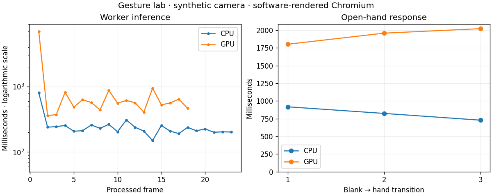

# Hand-tracking baseline

**Scope.** This experiment uses the real gallery, MediaPipe SDK, hand model, classifier and particle callback at commit `4bb8b0e2b3a7993614c809d7613001da49516e56`. The camera is a synthetic canvas stream alternating between blank frames and the SDK's open-hand fixture. Each delegate runs on the same headless Chromium/ANGLE SwiftShader machine. Neither phone thermals nor physical sensor-to-photon latency can be inferred from these observations.

## Chart 4 and measured results



| Chromium 153.0.8010.0 on SwiftShader | Production CPU delegate | Experimental GPU delegate |
| --- | ---: | ---: |
| Synthetic source rate | 30.0 Hz | 29.9 Hz |
| Accepted samples and mean accepted rate, including first inference | 23 at 3.35 Hz | 18 at 0.99 Hz |
| First inference | 804 ms | 6,970 ms |
| Median worker inference | 226.4 ms | 565.5 ms |
| Median bitmap creation | 0.3 ms | 0.3 ms |
| Median worker round trip | 227.2 ms | 566.8 ms |
| Median fixture transition → particle action, three transitions | 824.2 ms | 1,957.9 ms |
| Worker ready, initial / restart | 3,324 / 1,215 ms | 3,950 / 4,095 ms |

Three Open transitions reached the particle callback under each delegate. An inference slot stayed occupied across slow frames, limiting the accepted rate well below the nominal 12.5 Hz. The software GPU delegate had a particularly expensive first inference. Retain CPU as the default for this change. A physical Redmi run is needed to compare delegates on its actual driver. Real-camera delivery, other pose accuracy, movement-to-photon latency and heat during sustained use remain unmeasured.

Both delegates stopped two tracks and terminated both workers after switch and stop. Denied camera access produced the status fallback. At the 480 × 300 viewport the floating skeleton canvas intercepted clicks on **Stop camera**. Injecting the candidate stylesheet, which makes the display-only inset transparent to pointer input, allowed the same pointer click to reach Stop and end the camera.

[Raw measurements](measurements.json) · [Measurement harness](probe.cjs) · [Chart generation](summarize.py)

## What the source does

Camera acquisition requests 640 × 480 with a preferred facing mode. A classic worker loads the pinned runtime from the application's own origin and fetches Google's versioned model on startup. Network caching follows HTTP headers and the user's browser. Every camera restart creates a new worker and model instance. The default CPU delegate runs synchronously inside that worker, independently of the gallery render loop.

The producer checks every 80 ms (12.5 checks/s), rejects unchanged video timestamps and skips acquisition while a previous frame is in flight. The worker closes each transferred ImageBitmap. On stop or navigation the main thread invalidates outstanding asynchronous requests, clears the timer, ends media tracks and terminates the worker. Classification requires two matching samples for a pose transition. Swipe uses wrist displacement, sample time and a cooldown. A lost hand resets the pose candidate. The camera inset label updates before the two-sample pose has necessarily fired the particle gesture.

## Clock boundaries

- **Synthetic source rate** records actual canvas updates during the sampled window. The generator requests a new draw every 33 ms.
- **Accepted rate** uses actual worker-bound sample timestamps. A scheduled timer tick alone contributes no sample.
- **Bitmap time** measures the asynchronous main-thread createImageBitmap call.
- **Inference time** surrounds detectForVideo in the worker. It includes synchronous work performed by the SDK.
- **Worker round trip** measures post-bitmap handoff through the main-thread message listener. It includes inference, scheduling and messaging. GPU transfer or pure message latency cannot be isolated.
- **Open-hand response** measures first fixture draw showing a hand through execution of the particle gesture callback. It includes frame scheduling, synthetic video capture, model work, classification and the two-sample rule. Display scanout, human reaction, exposure time and completion of the animated morph are outside this measurement.
- **Startup** measures init message through ready acknowledgement. Model bytes are served from a local copy of the exact pinned download. These times exclude WAN download latency.

## Reproduction

Use Node 22 or later, npm, Playwright and an accessible Chromium executable. The probe compiles temporary builds of the original source with timing hooks. The candidate stylesheet is injected only after baseline stop-button hit testing, at the end of a delegate's timing run. No fixture media or modified model is shipped.

```sh
git worktree add --detach ../world-baseline 4bb8b0e2b3a7993614c809d7613001da49516e56
(cd ../world-baseline && npm ci)
npm install --prefix /tmp/xr-probe-tools playwright@1.62.1
curl -fL https://storage.googleapis.com/mediapipe-models/hand_landmarker/hand_landmarker/float16/1/hand_landmarker.task -o /tmp/xrhand.task
curl -fL https://storage.googleapis.com/mediapipe-assets/right_hands.jpg -o /tmp/xrhands.jpg
NODE_PATH=/tmp/xr-probe-tools/node_modules CHROMIUM_PATH=/path/to/chromium node docs/evidence/tracking/probe.cjs ../world-baseline /tmp/xrhand.task /tmp/xrhands.jpg docs/evidence/tracking/measurements.json src/style.css
python docs/evidence/tracking/summarize.py
```

The model's SHA-256 is `fbc2a30080c3c557093b5ddfc334698132eb341044ccee322ccf8bcf3607cde1`. The fixture's SHA-256 is `4b5134daa4cb60465535239535f9f74c2842aba3aa5fd30bf04ef5678f93d87f`. The chart script requires matplotlib. The harness substitutes the GPU delegate only for the comparison build. All camera frames, landmarks and timing analysis stay inside the test machine.
